# Architecture Views

PULSE pre-Azure review v0.3 · 2026-10-10 · Owner: Dr. Douglas Moore · Prepared for review

Fictional customer scenario; proposed design, not implementation or customer approval. Stop boundary: no Azure connection, provisioning, paid resources, site access or production release.

## Diagram index

Thirteen unique views; `.mmd`, `.svg` and `.png` are source, scalable preview and image export of the same diagram. Views 04/04b, 07/07b and 08/08b form the v0.2 correction. View 03 now uses explicit Bronze/Silver/Gold design v0.3. Other views retain v0.1.

| View | Purpose |
|---|---|
| [System Context and Authority](../diagrams/01_system_context.svg) | Distinguish reference evidence, future site sources and human authority. |
| [As-Is Workflow and Proposed Handoff](../diagrams/02_as_is_conops.svg) | Show the fictional current process and where advisory evidence would enter. |
| [Data Architecture — Bronze, Silver and Gold](../diagrams/03_data_lineage.svg) | Preserve authorized source bytes, promote validated bearing/run records and publish versioned features and advisory products with lineage. |
| [AI/ML Training and Registration](../diagrams/04_model_lifecycle.svg) | Trace qualified signals through leakage-safe preparation, candidate evaluation and versioned registration; registration does not authorize release. |
| [Inference, Monitoring and Revalidation](../diagrams/04b_inference_monitoring.svg) | Bind scoring to the released preprocessing/model/policy versions, preserve abstention and human authority, and route change signals to reviewed revalidation. |
| [Advisory Policy and Human Decisions](../diagrams/05_human_decision.svg) | Model output cannot bypass eligibility or customer approval. |
| [Security and Trust Zones](../diagrams/06_security_boundaries.svg) | Separate future plant collection, processing and restricted evidence access. |
| [Proposed Azure Environment Topology](../diagrams/07_deployment_candidate.svg) | Separate reference development, release validation and later site deployment; show storage, compute, model assets and operational evidence without binding resources. |
| [Proposed Network and Identity Paths](../diagrams/07b_network_identity.svg) | Distinguish private inbound client access from managed compute egress and identity authorization; resource placement is logical, not an implemented network. |
| [Release and Promotion](../diagrams/08_release_gates.svg) | Bind each promotion to verified artifacts, an exact destination, current evidence and release authority; failures deny new exposure. |
| [Rollback and Safe Recovery](../diagrams/08b_rollback_recovery.svg) | Withdraw affected advisories, assess the prior release and recover the full approved bundle or remain unavailable. |
| [Observability, Degraded Mode and Recovery](../diagrams/09_operations_recovery.svg) | Connect runtime signals to accountable human response and revalidation. |
| [Requirements, Risks and Evidence Trace](../diagrams/10_traceability.svg) | Join stakeholder needs and controls to evidence-bound review decisions. |

All components and controls are proposed. Solid edges describe intended interactions, not existing connections; dashed edges mark later site scope. Resource groups are administrative boundaries, not network isolation. Identity authorization does not create a route. Related versions and authority must agree across views.

## System Context and Authority

Distinguish reference evidence, future site sources and human authority. Status: proposed/unimplemented; view v0.1. Requirements: PULSE-SR-001;PULSE-FR-007;AIG-REQ-003.

[Editable source](../diagrams/01_system_context.mmd) · [SVG preview](../diagrams/01_system_context.svg) · [PNG export](../diagrams/01_system_context.png)

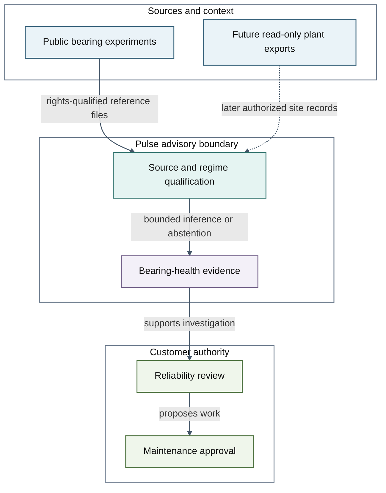

Legend: Blue—sources; Teal—data; Green—people; Purple—evidence.

## As-Is Workflow and Proposed Handoff

Show the fictional current process and where advisory evidence would enter. Status: proposed/unimplemented; view v0.1. Requirements: PULSE-FR-007;PULSE-FR-008.

[Editable source](../diagrams/02_as_is_conops.mmd) · [SVG preview](../diagrams/02_as_is_conops.svg) · [PNG export](../diagrams/02_as_is_conops.png)

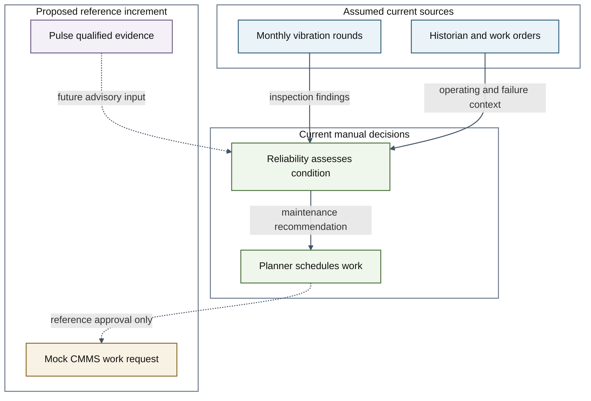

Legend: Blue—sources; Gold—policy; Green—people; Purple—evidence.

## Data Architecture — Bronze, Silver and Gold

Preserve authorized source bytes, promote validated bearing/run records and publish versioned features and advisory products with lineage. Status: proposed/unimplemented; view v0.3. Requirements: PULSE-FR-001;PULSE-FR-002;PULSE-NFR-008;PULSE-NFR-006;PULSE-NFR-007;AIG-REQ-001.

[Layer contracts and promotion rules](../04-data-architecture-and-digital-thread.md) · [ADR-009](../../architecture/adr/adr-009.md)

[Editable source](../diagrams/03_data_lineage.mmd) · [SVG preview](../diagrams/03_data_lineage.svg) · [PNG export](../diagrams/03_data_lineage.png)

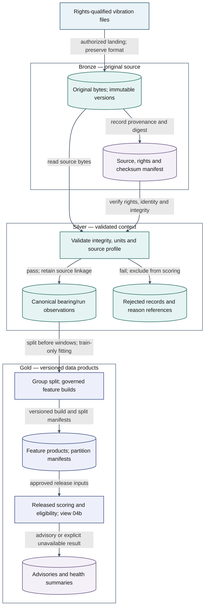

Legend: Blue—sources; Teal—data; Indigo—models; Purple—evidence. Bronze/Silver/Gold are maturity layers, not node colors; the approved DME palette retains its semantic roles.

## AI/ML Training and Registration

Trace qualified signals through leakage-safe preparation, candidate evaluation and versioned registration; registration does not authorize release. Status: proposed/unimplemented; view v0.2. Requirements: PULSE-FR-001;PULSE-FR-003;PULSE-FR-005;PULSE-FR-006;PULSE-NFR-008;AIG-REQ-001.

[Editable source](../diagrams/04_model_lifecycle.mmd) · [SVG preview](../diagrams/04_model_lifecycle.svg) · [PNG export](../diagrams/04_model_lifecycle.png)

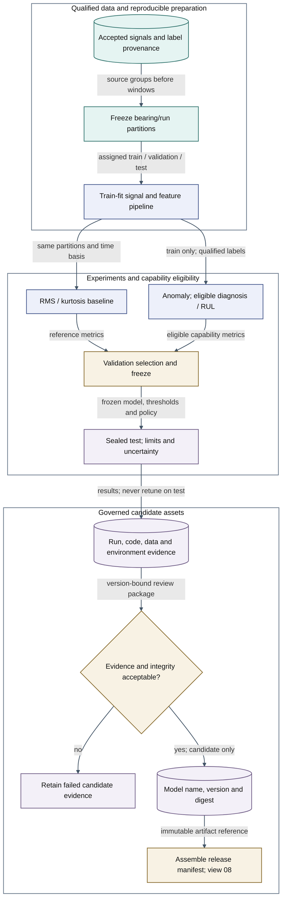

Legend: Teal—data; Indigo—models; Gold—policy; Purple—evidence.

## Inference, Monitoring and Revalidation

Bind scoring to the released preprocessing/model/policy versions, preserve abstention and human authority, and route change signals to reviewed revalidation. Status: proposed/unimplemented; view v0.2. Requirements: PULSE-FR-002;PULSE-FR-004;PULSE-FR-007;PULSE-SR-004;AIG-REQ-001;AIG-REQ-002.

[Editable source](../diagrams/04b_inference_monitoring.mmd) · [SVG preview](../diagrams/04b_inference_monitoring.svg) · [PNG export](../diagrams/04b_inference_monitoring.png)

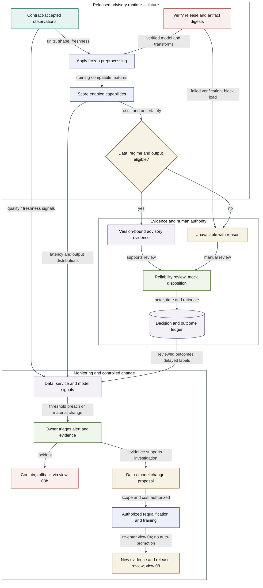

Legend: Teal—data; Indigo—models; Gold—policy; Green—people; Purple—evidence; Rose—security.

## Advisory Policy and Human Decisions

Model output cannot bypass eligibility or customer approval. Status: proposed/unimplemented; view v0.1. Requirements: PULSE-FR-004;PULSE-FR-007;PULSE-SR-001.

[Editable source](../diagrams/05_human_decision.mmd) · [SVG preview](../diagrams/05_human_decision.svg) · [PNG export](../diagrams/05_human_decision.png)

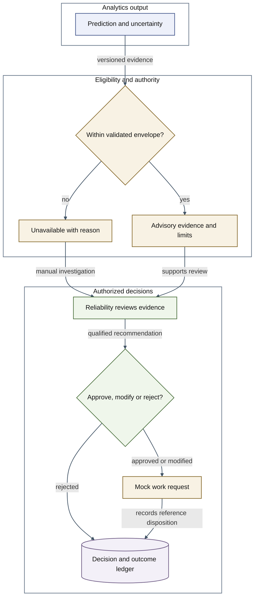

Legend: Indigo—models; Gold—policy; Green—people; Purple—evidence.

## Security and Trust Zones

Separate future plant collection, processing and restricted evidence access. Status: proposed/unimplemented; view v0.1. Requirements: PULSE-SR-001;PULSE-SR-002;PULSE-SR-003;PULSE-SR-004.

[Editable source](../diagrams/06_security_boundaries.mmd) · [SVG preview](../diagrams/06_security_boundaries.svg) · [PNG export](../diagrams/06_security_boundaries.png)

```mermaid
%% Security and Trust Zones | Proposed design, not deployed | PULSE v0.1
flowchart TD
subgraph sg_ot["Future plant boundary"]
 source["Plant source systems"]
 intermediary["Approved read-only intermediary"]
end
subgraph sg_security["Identity and network controls"]
 identity["Named organizational identity"]
 private["Private access and scoped roles"]
end
subgraph sg_work["Controlled reference workspace"]
 ingest["Contract and integrity checks"]
 artifacts[("Restricted data and artifacts")]
 viewer["Advisory evidence viewer"]
end
source -.->|"read or approved export only"| intermediary
intermediary -.->|"later qualified records"| ingest
identity -->|"authenticates approved actor"| private
private -->|"authorizes access"| artifacts
ingest -->|"validated source and model digests"| artifacts
artifacts -->|"minimal evidence"| viewer
class source source
class intermediary,identity,private security
class ingest data
class artifacts,viewer evidence
  classDef source fill:#EAF3F8,stroke:#356079,stroke-width:1.5px,color:#111111
  classDef data fill:#E5F4F2,stroke:#32746E,stroke-width:1.5px,color:#111111
  classDef model fill:#EDF0FA,stroke:#42558B,stroke-width:1.5px,color:#111111
  classDef policy fill:#F8F2E4,stroke:#876A2D,stroke-width:1.5px,color:#111111
  classDef human fill:#EFF6EB,stroke:#4C713E,stroke-width:1.5px,color:#111111
  classDef evidence fill:#F3F0F8,stroke:#6E5B85,stroke-width:1.5px,color:#111111
  classDef security fill:#FBEFED,stroke:#9B534C,stroke-width:1.5px,color:#111111
  style sg_ot fill:none,stroke:#657588,stroke-width:1.5px,color:#111111
  style sg_security fill:none,stroke:#657588,stroke-width:1.5px,color:#111111
  style sg_work fill:none,stroke:#657588,stroke-width:1.5px,color:#111111
  linkStyle default stroke:#425466,stroke-width:1.5px
```

Legend: Blue—sources; Teal—data; Purple—evidence; Rose—security.

## Proposed Azure Environment Topology

Separate reference development, release validation and later site deployment; show storage, compute, model assets and operational evidence without binding resources. Status: proposed/unimplemented; view v0.2. Requirements: PULSE-SR-002;PULSE-SR-003;AIG-REQ-001;AIG-REQ-002;PULSE-COST-REQ-001.

[Editable source](../diagrams/07_deployment_candidate.mmd) · [SVG preview](../diagrams/07_deployment_candidate.svg) · [PNG export](../diagrams/07_deployment_candidate.png)

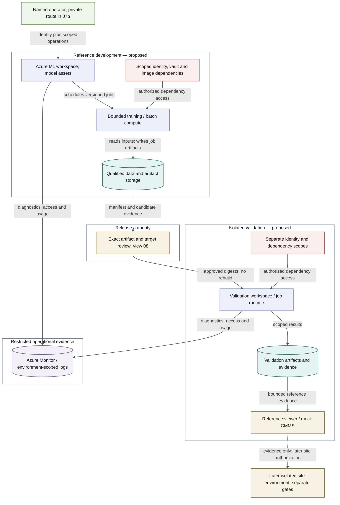

Legend: Teal—data; Indigo—models; Gold—policy; Green—people; Purple—evidence; Rose—security.

## Proposed Network and Identity Paths

Distinguish private inbound client access from managed compute egress and identity authorization; resource placement is logical, not an implemented network. Status: proposed/unimplemented; view v0.2. Requirements: PULSE-SR-001;PULSE-SR-002;PULSE-SR-003;PULSE-SR-004.

[Editable source](../diagrams/07b_network_identity.mmd) · [SVG preview](../diagrams/07b_network_identity.svg) · [PNG export](../diagrams/07b_network_identity.png)

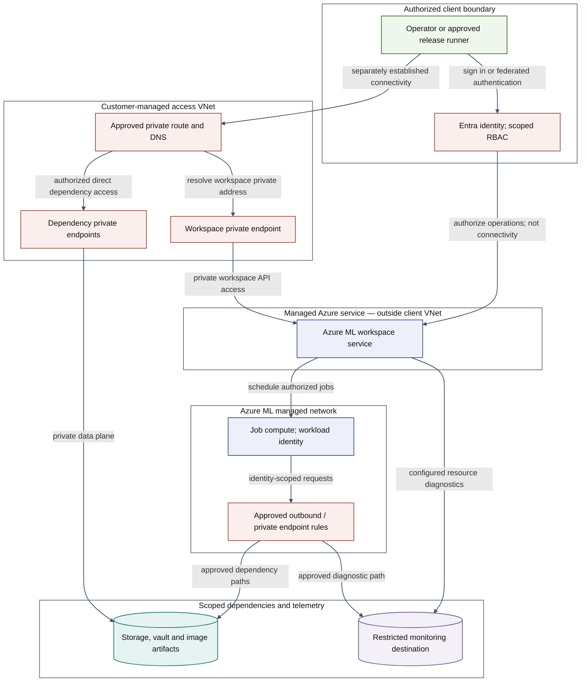

Legend: Teal—data; Indigo—models; Green—people; Purple—evidence; Rose—security.

## Release and Promotion

Bind each promotion to verified artifacts, an exact destination, current evidence and release authority; failures deny new exposure. Status: proposed/unimplemented; view v0.2. Requirements: AIG-REQ-001;AIG-REQ-002;AIG-REQ-003;PULSE-SR-004;PULSE-NFR-004.

[Editable source](../diagrams/08_release_gates.mmd) · [SVG preview](../diagrams/08_release_gates.svg) · [PNG export](../diagrams/08_release_gates.png)

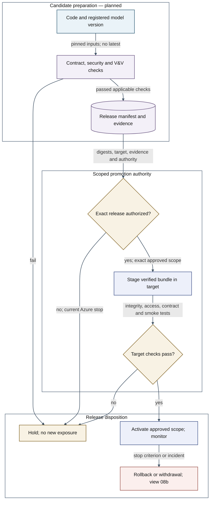

Legend: Blue—sources; Indigo—models; Gold—policy; Purple—evidence; Rose—security.

## Rollback and Safe Recovery

Withdraw affected advisories, assess the prior release and recover the full approved bundle or remain unavailable. Status: proposed/unimplemented; view v0.2. Requirements: PULSE-SR-004;PULSE-NFR-004;PULSE-NFR-005;AIG-REQ-001;AIG-REQ-002.

[Editable source](../diagrams/08b_rollback_recovery.mmd) · [SVG preview](../diagrams/08b_rollback_recovery.svg) · [PNG export](../diagrams/08b_rollback_recovery.png)

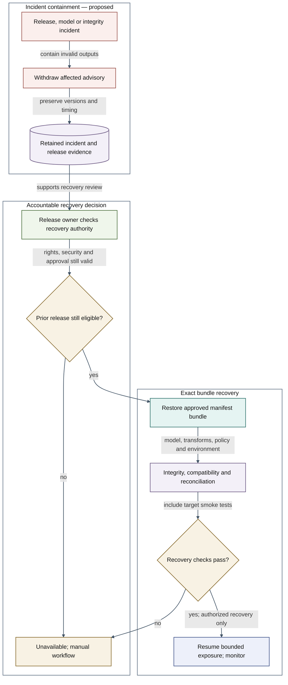

Legend: Teal—data; Indigo—models; Gold—policy; Green—people; Purple—evidence; Rose—security.

## Observability, Degraded Mode and Recovery

Connect runtime signals to accountable human response and revalidation. Status: proposed/unimplemented; view v0.1. Requirements: PULSE-NFR-003;PULSE-NFR-004;PULSE-NFR-005.

[Editable source](../diagrams/09_operations_recovery.mmd) · [SVG preview](../diagrams/09_operations_recovery.svg) · [PNG export](../diagrams/09_operations_recovery.png)

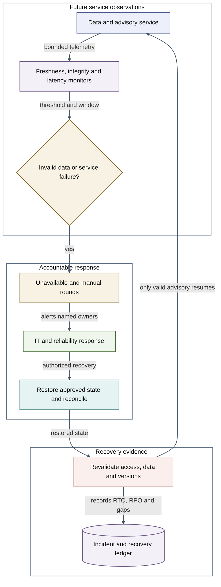

Legend: Teal—data; Indigo—models; Gold—policy; Green—people; Purple—evidence; Rose—security.

## Requirements, Risks and Evidence Trace

Join stakeholder needs and controls to evidence-bound review decisions. Status: proposed/unimplemented; view v0.1. Requirements: AIG-REQ-001;AIG-REQ-002.

[Editable source](../diagrams/10_traceability.mmd) · [SVG preview](../diagrams/10_traceability.svg) · [PNG export](../diagrams/10_traceability.png)

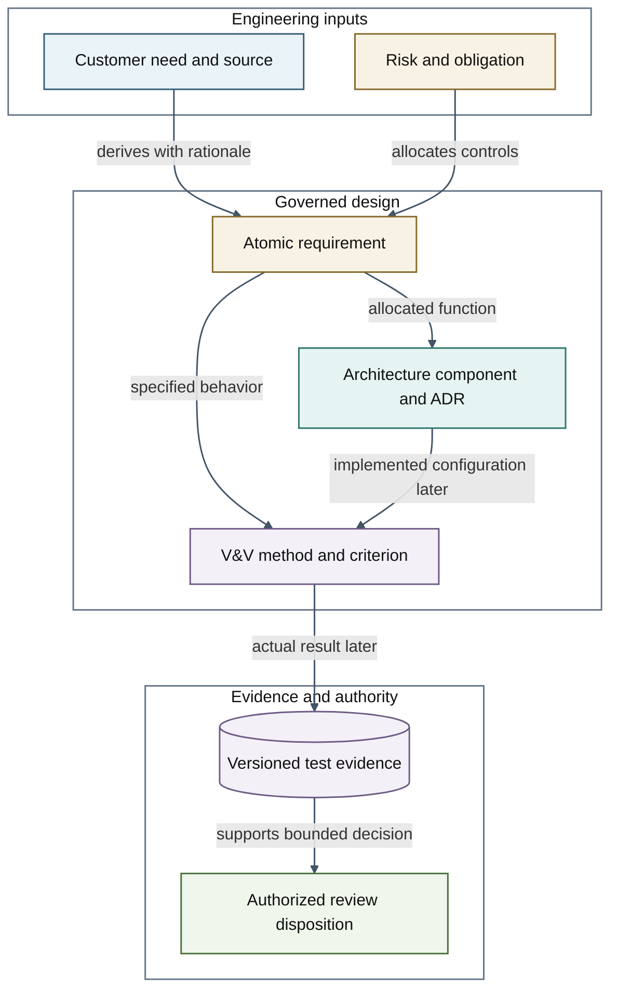

Legend: Blue—sources; Teal—data; Gold—policy; Green—people; Purple—evidence.
