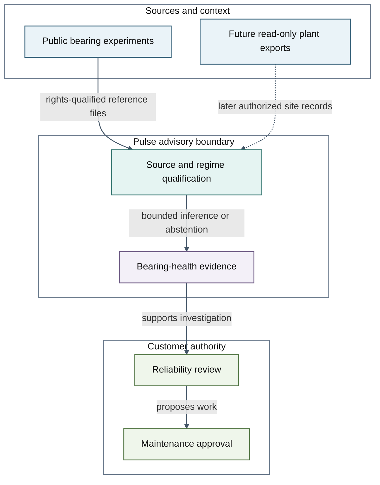
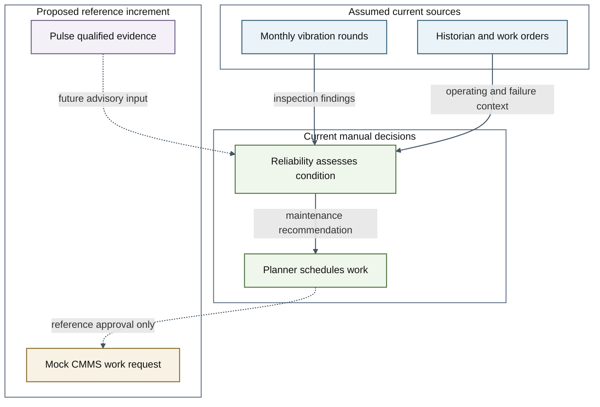
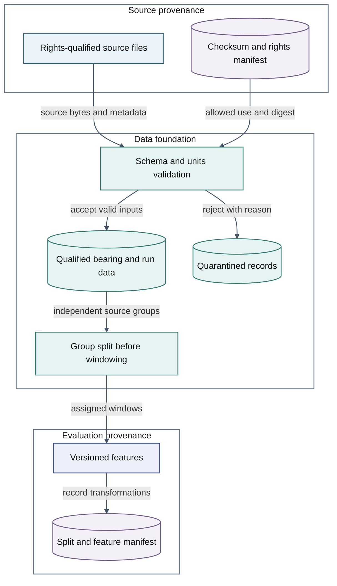
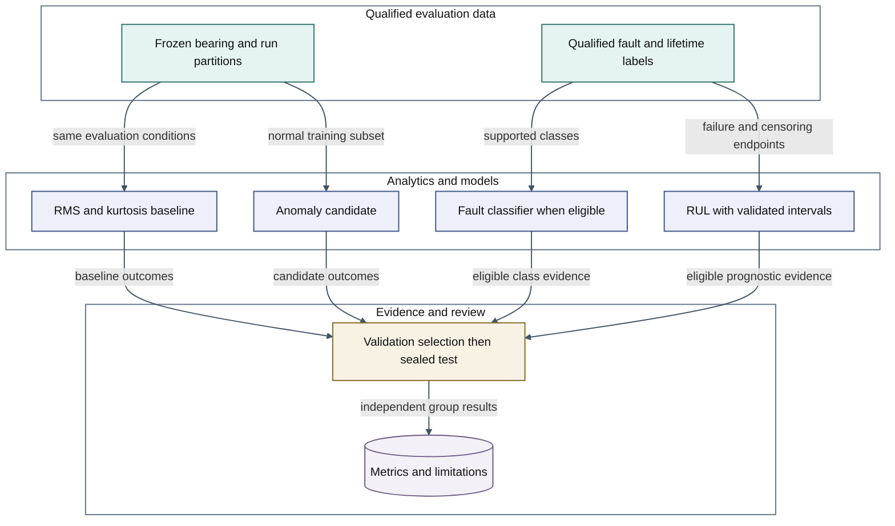
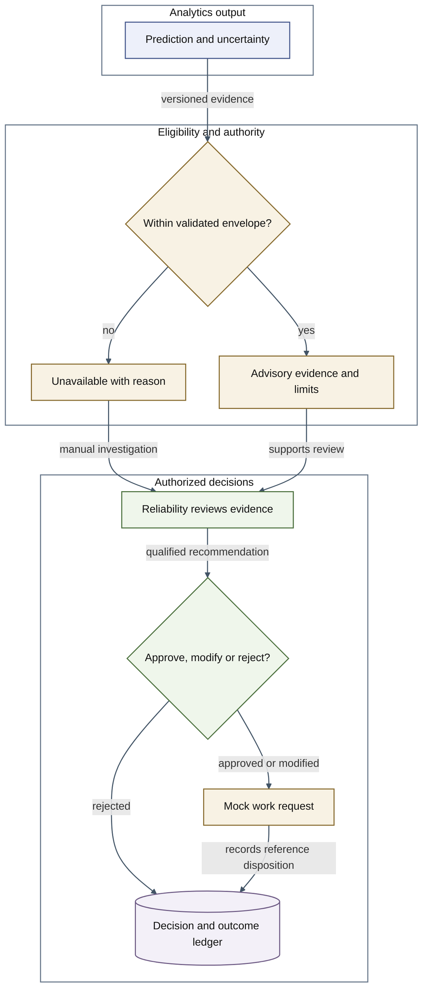
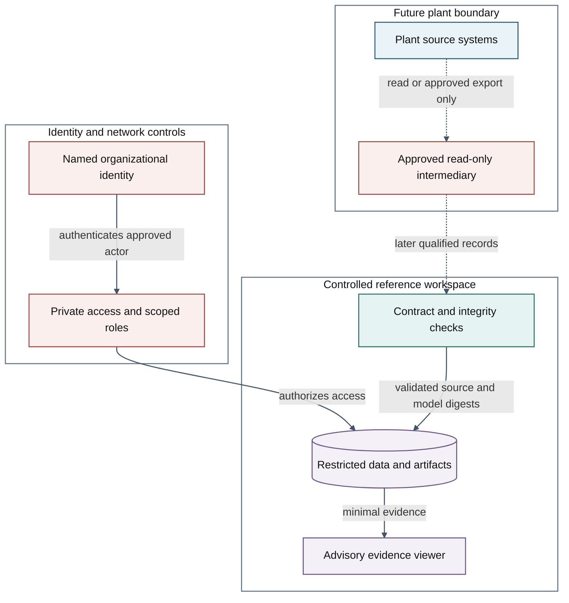
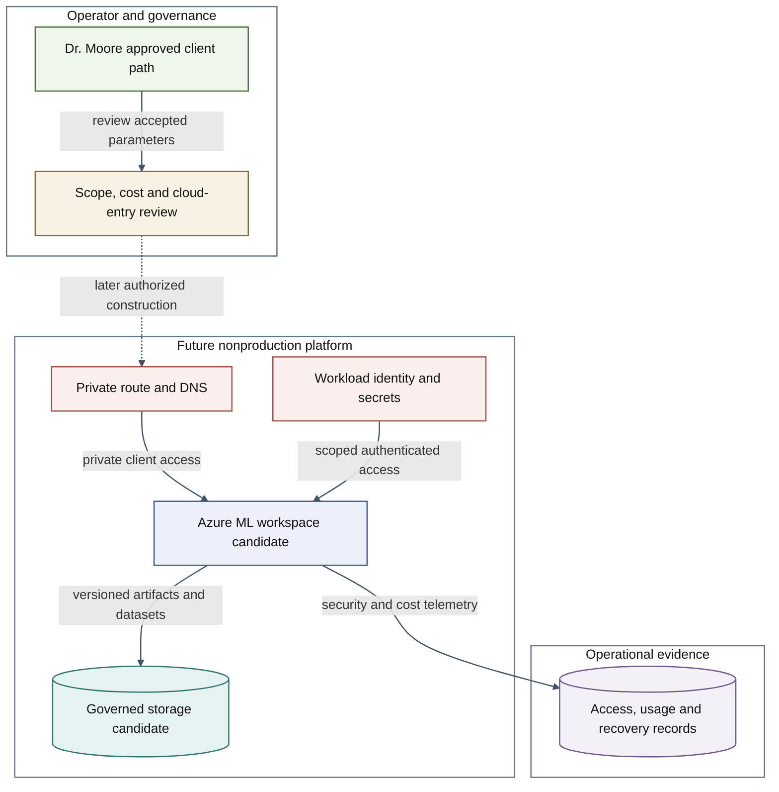
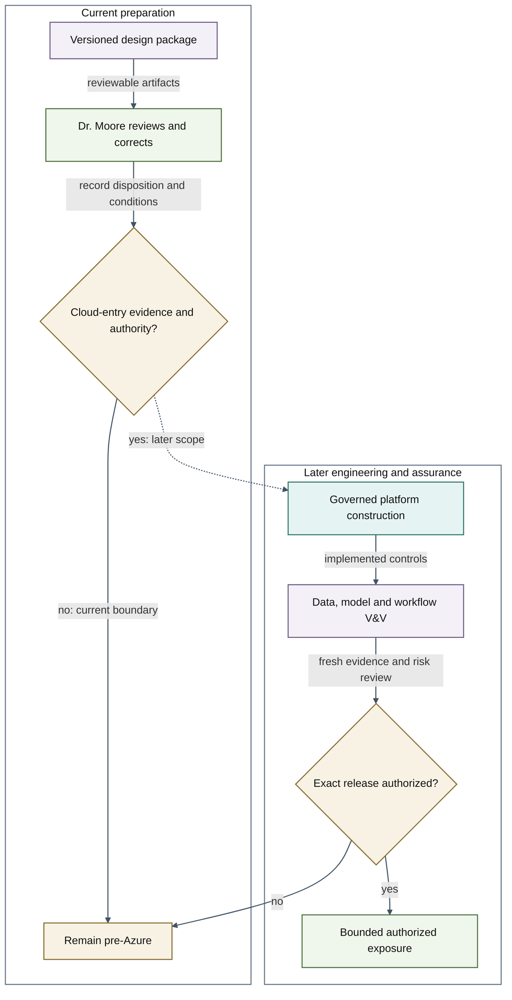
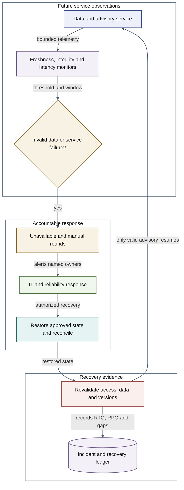
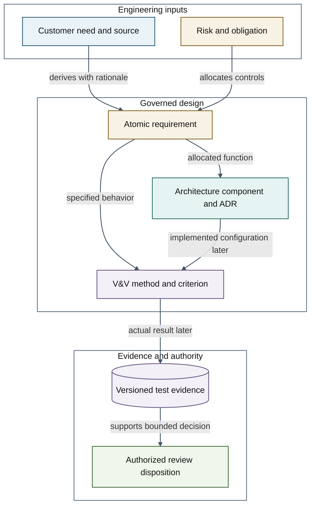

# Architecture Views

PULSE pre-Azure review v0.1 · 2026-10-10 · Owner: Dr. Douglas Moore · Prepared for review

Fictional customer scenario; proposed design, not implementation or customer approval. Stop boundary: no Azure connection, provisioning, paid resources, site access or production release.

View correspondence: source/run/evidence IDs and authority boundaries must agree across all views, requirements and ADRs. Dashed edges represent future scope or unbuilt transitions, never existing connections. All controls and cloud resources are proposals. Sources and labels differ by view purpose; no graphic grants authority.

## System Context and Authority

Distinguish reference evidence, future site sources and human authority. Status: proposed/unimplemented. Requirements: PULSE-SR-001;PULSE-FR-007;AIG-REQ-003.

[Editable source](../diagrams/01_system_context.mmd) · [SVG preview](../diagrams/01_system_context.svg)

Legend: Blue—sources; Teal—data; Indigo—models; Gold—policy; Green—people; Purple—evidence; Rose—security.

## As-Is Workflow and Proposed Handoff

Show the fictional current process and where advisory evidence would enter. Status: proposed/unimplemented. Requirements: PULSE-FR-007;PULSE-FR-008.

[Editable source](../diagrams/02_as_is_conops.mmd) · [SVG preview](../diagrams/02_as_is_conops.svg)

Legend: Blue—sources; Teal—data; Indigo—models; Gold—policy; Green—people; Purple—evidence; Rose—security.

## Data Architecture and Lineage

Keep rejected data apart and propagate immutable source/split identities. Status: proposed/unimplemented. Requirements: PULSE-FR-001;PULSE-FR-002;PULSE-NFR-008.

[Editable source](../diagrams/03_data_lineage.mmd) · [SVG preview](../diagrams/03_data_lineage.svg)

Legend: Blue—sources; Teal—data; Indigo—models; Gold—policy; Green—people; Purple—evidence; Rose—security.

## AI Capability and Evaluation Lifecycle

Separate anomaly, diagnosis and RUL eligibility; protect the test holdout. Status: proposed/unimplemented. Requirements: PULSE-FR-003;PULSE-FR-005;PULSE-FR-006.

[Editable source](../diagrams/04_model_lifecycle.mmd) · [SVG preview](../diagrams/04_model_lifecycle.svg)

Legend: Blue—sources; Teal—data; Indigo—models; Gold—policy; Green—people; Purple—evidence; Rose—security.

## Advisory Policy and Human Decisions

Model output cannot bypass eligibility or customer approval. Status: proposed/unimplemented. Requirements: PULSE-FR-004;PULSE-FR-007;PULSE-SR-001.

[Editable source](../diagrams/05_human_decision.mmd) · [SVG preview](../diagrams/05_human_decision.svg)

Legend: Blue—sources; Teal—data; Indigo—models; Gold—policy; Green—people; Purple—evidence; Rose—security.

## Security and Trust Zones

Separate future plant collection, processing and restricted evidence access. Status: proposed/unimplemented. Requirements: PULSE-SR-001;PULSE-SR-002;PULSE-SR-003;PULSE-SR-004.

[Editable source](../diagrams/06_security_boundaries.mmd) · [SVG preview](../diagrams/06_security_boundaries.svg)

Legend: Blue—sources; Teal—data; Indigo—models; Gold—policy; Green—people; Purple—evidence; Rose—security.

## Azure Capability Mapping — Proposed

Map logical capabilities without claiming resources or selecting measured SKUs. Status: proposed/unimplemented. Requirements: PULSE-SR-002;PULSE-SR-003;PULSE-COST-REQ-001.

[Editable source](../diagrams/07_deployment_candidate.mmd) · [SVG preview](../diagrams/07_deployment_candidate.svg)

Legend: Blue—sources; Teal—data; Indigo—models; Gold—policy; Green—people; Purple—evidence; Rose—security.

## Release and Promotion Gates

Require evidence and authority; current work stops before cloud entry. Status: proposed/unimplemented. Requirements: AIG-REQ-002;AIG-REQ-003.

[Editable source](../diagrams/08_release_gates.mmd) · [SVG preview](../diagrams/08_release_gates.svg)

Legend: Blue—sources; Teal—data; Indigo—models; Gold—policy; Green—people; Purple—evidence; Rose—security.

## Observability, Degraded Mode and Recovery

Connect runtime signals to accountable human response and revalidation. Status: proposed/unimplemented. Requirements: PULSE-NFR-003;PULSE-NFR-004;PULSE-NFR-005.

[Editable source](../diagrams/09_operations_recovery.mmd) · [SVG preview](../diagrams/09_operations_recovery.svg)

Legend: Blue—sources; Teal—data; Indigo—models; Gold—policy; Green—people; Purple—evidence; Rose—security.

## Requirements, Risks and Evidence Trace

Join stakeholder needs and controls to evidence-bound review decisions. Status: proposed/unimplemented. Requirements: AIG-REQ-001;AIG-REQ-002.

[Editable source](../diagrams/10_traceability.mmd) · [SVG preview](../diagrams/10_traceability.svg)

Legend: Blue—sources; Teal—data; Indigo—models; Gold—policy; Green—people; Purple—evidence; Rose—security.
